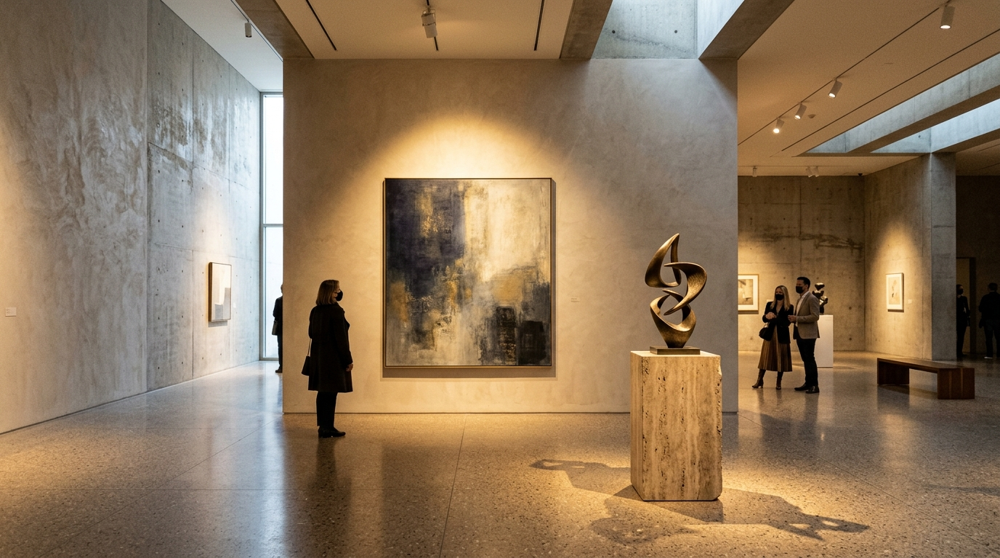
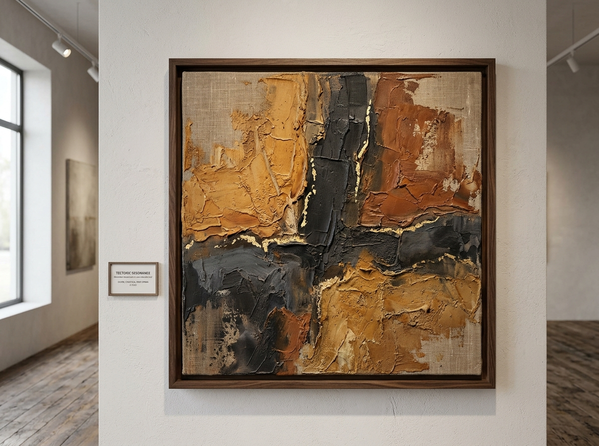
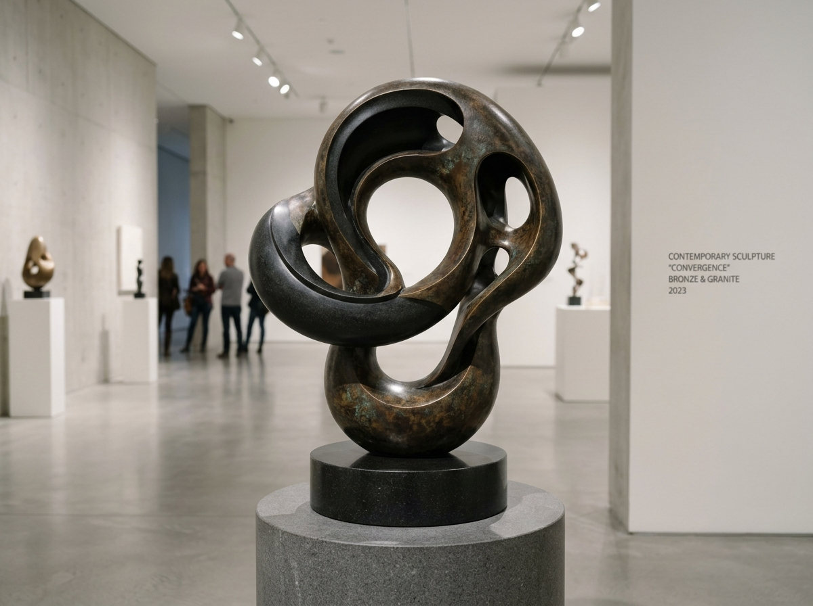
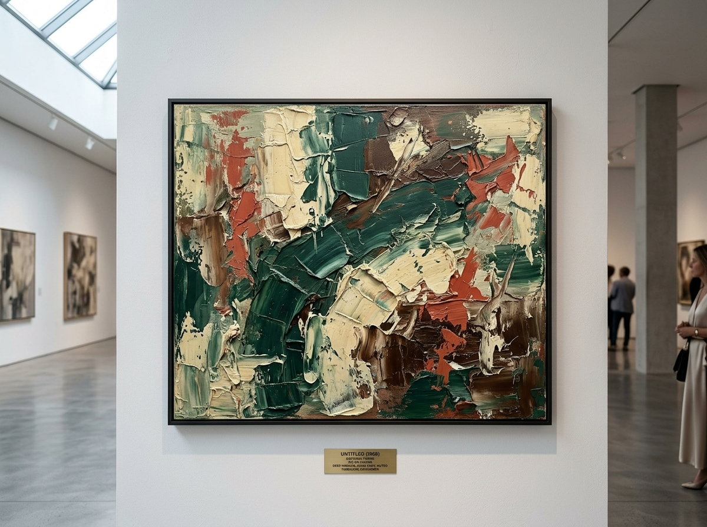
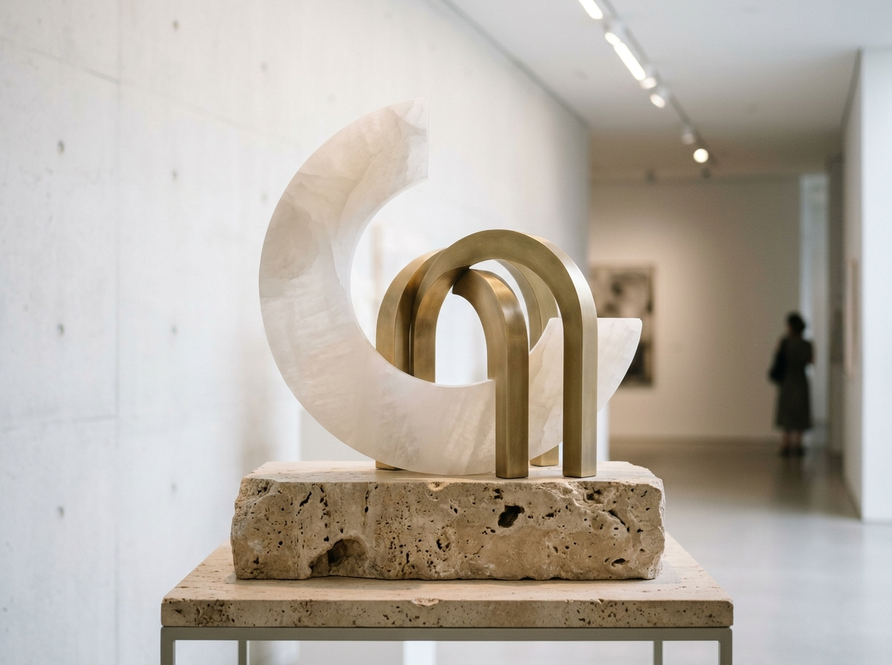
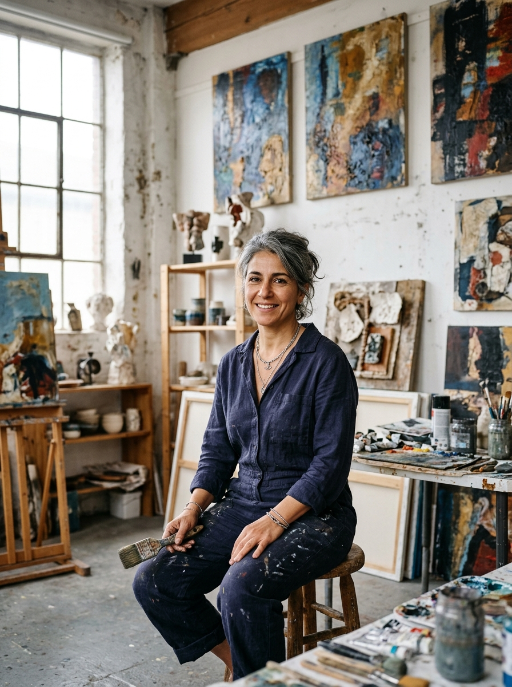

# Dhurva's Art Studio & Gallery 🎨🏛️

An exclusive contemporary fine art exhibition and acquisitions platform showcasing museum-grade paintings and architectural sculptures with high-resolution visual galleries, tactile artist profiles, seamless multi-step checkout, and a password-protected curatorial admin dashboard.

---

## 🖼️ Gallery Preview & Curated Works

<div align="center">
  
  <p><em>Grand Vernissage 2026 — Master Exhibition Hall at Dhurva's Art Studio & Gallery</em></p>
</div>

### Featured Permanent Collection

| Artwork | Title & Artist | Medium & Dimensions | Acquisition |
| :---: | :--- | :--- | :---: |
|  | **Cosmic Stillness: Tectonic Resonance No. 4**<br/>by *Dhurva* | Oil, volcanic ash & 24k gold leaf on Belgian linen<br/>`140 × 140 cm (55 × 55 in)` | **$16,500 USD**<br/>*Available* |
|  | **Convergence in Void**<br/>by *Marcus Thorne* | Lost-wax patinated bronze on Belgian granite<br/>`88 × 64 × 42 cm (34.6 × 25.2 in)` | **$18,200 USD**<br/>*Available* |
|  | **Viridian Strata**<br/>by *Camille Laurent* | Palette knife oil & cold wax on archival canvas<br/>`120 × 100 cm (47.2 × 39.4 in)` | **$9,800 USD**<br/>*Available* |
|  | **Celestial Cadence**<br/>by *Anya Rostova* | Hand-carved Spanish alabaster & satin brass<br/>`62 × 48 × 30 cm (24.4 × 18.9 in)` | **$11,400 USD**<br/>*Available* |
|  | **Studio Master Atelier**<br/>*Dhurva in his atelier* | Exploration of ancient Vedic spatial philosophy & textured mineral pigments | *Principal Artist & Founder* |

---

## ✨ Key Platform Features

### 1. Architectural Welcoming Entrance
- **Full-Screen Atmospheric Greeting**: 3-second animated countdown with manual "Enter Gallery" bypass.
- **Cinematic Transitions**: Exhibition-grade staggered reveals, subtle blur-dissolve, and typography honors the physical museum experience.

### 2. High-Resolution Artwork Inspection
- **Pristine Detail Zoom**: Examine pigment textures, brushstroke topography, and bronze patinas.
- **Museum Framing Options**:
  - *Floating Solid American Walnut Shadowbox* (+$450)
  - *Brushed Charcoal Aluminum Gallery Frame with Tru-Vue 99% UV Glass* (+$380)
  - *Gallery Stretched Canvas / Raw Plinth* ($0)
- **Scale Reference**: Human scale visualization comparison (178 cm standard height).

### 3. Touch-to-Reveal Artist Studio Pages
- **Inline Gallery Integration**: When visitors touch any artist profile (Dhurva, Hélène Vance, Marcus Thorne, Camille Laurent, Anya Rostova), the page smoothly scrolls and filters directly to that artist's works without breaking context.
- **Complete Provenance**: Biography, artistic philosophy, active exhibitions (Venice Biennale, Grand Palais Éphémère), and education credentials.

### 4. Seamless Acquisitions Flow
- **Direct "Buy Now" & Multi-Item Cart**: Fluid slider drawer with real-time framing updates.
- **Collector Dossier Checkout**: Full collection of collector details (Full Name, Phone Number, Delivery Address, Suite/Penthouse, Custom Handling Instructions).
- **White-Glove Art Courier**: Temperature-controlled insured freight handling with physical Certificate of Authenticity (COA) registration.

### 5. Private Curator Admin Panel
- **Discreet Access**: Accessible from navigation with passkey verification (`curator2026`).
- **Complete Order Records**: Review client addresses, phone numbers, special freight instructions, payment verification, and courier tracking numbers.
- **Inventory Control**: Real-time toggling of artwork availability (`Available`, `Reserved`, `Sold`).

---

## 🛠️ Technology Stack

- **Framework**: [React 19](https://react.dev/) + [TypeScript](https://www.typescriptlang.org/)
- **Bundler & Build Tool**: [Vite 8](https://vitejs.dev/) with native ES module asset hashing
- **Styling**: [Tailwind CSS v4](https://tailwindcss.com/)
- **Animation**: [Motion 12](https://motion.dev/) (orchestrated stagger variants & layout morphs)
- **Iconography**: [Lucide React](https://lucide.dev/)
- **Fonts**: *Playfair Display* (editorial serif typography) & *Plus Jakarta Sans* (refined modern UI)

---

## 🚀 Getting Started

### Prerequisites
- Node.js 18+ or 20+
- npm, pnpm, or bun

### Installation

```bash
# Clone the repository
git clone https://github.com/your-username/dhurvas-art-studio.git
cd dhurvas-art-studio

# Install dependencies
npm install

# Start local development server
npm run dev
```

Visit `http://localhost:3000` in your browser.

### Production Build

```bash
# Compile and bundle static assets with uncompressed high-resolution images
npm run build

# Preview production build locally
npm run preview
```

The output will be generated inside the `dist/` directory, ready to deploy to any modern static hosting service (Cloud Run, Vercel, Netlify, GitHub Pages).

---

## 📂 Repository Structure

```
├── public/
│   └── images/                     # Direct web-accessible high-resolution image assets
│       ├── hero.jpg                # Grand gallery exhibition hero
│       ├── solitude.jpg            # Dhurva / Hélène Vance paintings
│       ├── botanical.jpg           # Camille Laurent botanical impasto
│       ├── monolith.jpg            # Marcus Thorne bronze sculpture
│       ├── celestial.jpg           # Anya Rostova alabaster sculpture
│       └── dhurva_studio.jpg       # Dhurva atelier studio portrait
├── src/
│   ├── assets/images/              # Bundled source images
│   ├── components/                 # UI components
│   │   ├── ArtworkDetailModal.tsx  # High-res inspection modal with framing selector
│   │   ├── ArtworkGrid.tsx         # Curated catalogue with smooth entry animations
│   │   ├── ArtistSection.tsx       # Artist showcase with touch-to-filter
│   │   ├── CartDrawer.tsx          # Collector acquisition bag
│   │   ├── CheckoutModal.tsx       # Multi-step white-glove checkout
│   │   ├── AdminPanelModal.tsx     # Private curator dashboard (passkey: curator2026)
│   │   ├── WelcomingIntroPopup.tsx # Full atmospheric welcoming entrance
│   │   ├── Hero.tsx                # Hero banner with vernissage preview
│   │   └── Navbar.tsx              # Minimalist header navigation
│   ├── context/
│   │   └── GalleryContext.tsx      # Central state (artworks, cart, orders, filters)
│   ├── data/
│   │   ├── artworks.ts             # Art catalogue data & initial orders
│   │   └── artists.ts              # Studio master artist profiles
│   ├── types/
│   │   └── index.ts                # TypeScript interfaces
│   ├── App.tsx                     # Main application layout
│   └── main.tsx                    # React DOM entrypoint
├── index.html                      # HTML entry with OpenGraph & font links
├── package.json
└── vite.config.ts
```

---

## 🔐 Curator Admin Passkey

For gallery staff and curator access:
- **Passkey**: `curator2026`
- **Location**: Top right navigation ("Curator Admin" button) or footer link.

---

## 📜 License & Provenance

© 2026 Dhurva's Art Studio & Gallery. All artwork rights, certificates of authenticity, and photographic reproductions are certified for exhibition and collector private acquisition.
